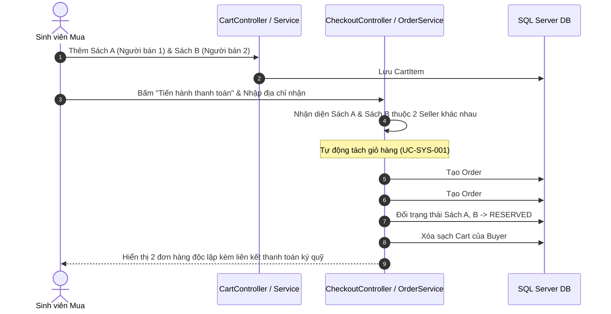
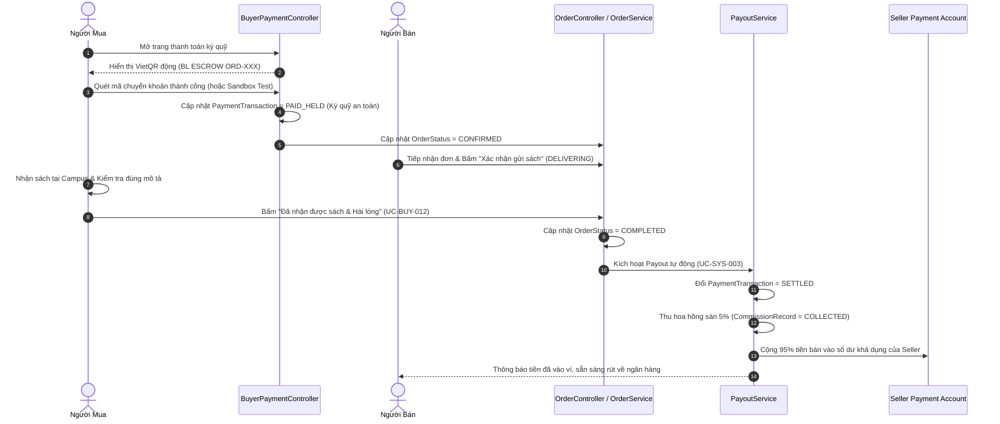
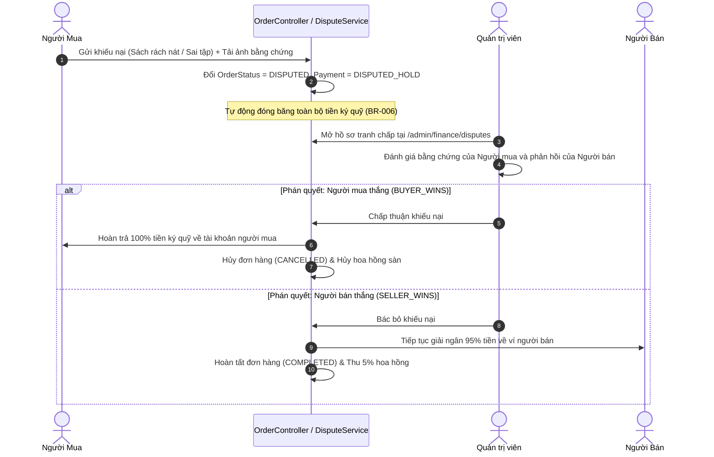

# BÁO CÁO PHÂN TÍCH USE CASE HỆ THỐNG BOOKLOOP
## Comprehensive Business Analysis, Architectural Specification & Gap Assessment
**Dự án:** BookLoop — Sàn thương mại điện tử C2C giáo trình & tài liệu học tập sinh viên  
**Khu vực trọng điểm:** Cụm đại học Hòa Lạc (FPT University, ĐHQG Hà Nội - VNU, Học viện Tài chính - AOF)  
**Tài liệu tham chiếu:** [`BookLoop_Use_Case_Specification.xlsx`](file:///c:/Users/ADMIN/Downloads/bookloop/bookloop/docs/business-analysis/BookLoop_Use_Case_Specification.xlsx)  
**Phiên bản:** 1.0.0 (Phase 7 Complete — Regression Verified 139/139 Tests Passing)

---

## 1. TỔNG QUAN HỆ THỐNG VÀ MÔ HÌNH KINH DOANH (BUSINESS MODEL)

### 1.1. Bối cảnh và Tầm nhìn
BookLoop là nền tảng công nghệ số kết nối cộng đồng sinh viên các trường đại học tại khu đô thị Hòa Lạc nhằm giải quyết bài toán lãng phí giáo trình chuyên ngành sau mỗi kỳ học. Thay vì mua sách mới với chi phí đắt đỏ hoặc bán đồng nát, sinh viên có thể đăng bán sách cũ cho các khóa sau với mức giá phải chăng.

### 1.2. Mô hình Kinh doanh C2C Marketplace with Partner Escrow
BookLoop không sở hữu hàng tồn kho và không trực tiếp mua bán sách. Nền tảng hoạt động theo mô hình **Sàn giao dịch C2C có ký quỹ đảm bảo (Marketplace with Conditional Fund Holding)**:
* **Dòng tiền người mua:** Khi đặt mua sách online, tiền được chuyển vào tài khoản trung gian ký quỹ (Escrow) của đối tác cổng thanh toán / sàn. Tiền không chuyển ngay cho người bán.
* **Thời gian bảo vệ:** Người bán có trách nhiệm hẹn gặp giao sách hoặc chuyển phát. Người mua có quyền kiểm tra sách trong 72 giờ.
* **Dòng doanh thu sàn:** Khi người mua xác nhận đã nhận được sách đúng mô tả, hệ thống giải ngân tiền bán cho người bán đồng thời tự động khấu trừ **5.0% phí hoa hồng sàn (Platform Commission)**.
* **Nguồn thu bổ sung:** Phí quảng cáo đẩy tin nổi bật (**10.000 ₫ / 7 ngày**).

---

## 2. PHÂN TÍCH TÁC TỬ HỆ THỐNG (ACTOR PROFILES & PERSONAS)

| Tác tử (Actor) | Bản chất / Vai trò kỹ thuật | Mục tiêu nghiệp vụ chính | Đặc điểm tương tác hệ thống |
| :--- | :--- | :--- | :--- |
| **Guest** | Người dùng vãng lai chưa xác thực | Tìm kiếm, xem giá sách, tra cứu giáo trình chuẩn, đăng ký tài khoản | Quyền Read-only với danh mục công khai; Chặn truy cập giỏ hàng và thanh toán. |
| **Student Buyer** | Sinh viên đã xác thực (`ROLE_STUDENT`) | Mua giáo trình, thanh toán ký quỹ an toàn, nhận hàng, đánh giá người bán | Quản lý giỏ hàng, đặt hàng, quét VietQR ký quỹ, xác nhận nhận hàng, khiếu nại. Không được tự mua sách của chính mình. |
| **Student Seller** | Sinh viên đã xác thực (`ROLE_STUDENT`) | Thanh lý sách cũ, đẩy tin nổi bật, xác nhận đơn, nhận tiền bán về tài khoản | Đăng tin (khớp giáo trình chính thức), quản lý tin, chấp nhận đơn, giao hàng, liên kết ngân hàng và rút tiền từ ví doanh thu. |
| **System Admin** | Quản trị viên (`ROLE_ADMIN`) | Giám sát vận hành, kiểm duyệt nội dung, trọng tài tranh chấp, đối soát dòng tiền | Toàn quyền kiểm duyệt tin đăng, khóa người dùng, cấu hình hoa hồng, xử lý tranh chấp, duyệt Payout lệnh lớn và chạy đối soát tự động. |
| **Payment Partner** | Hệ thống cổng thanh toán / Ngân hàng bên ngoài | Cung cấp hạ tầng VietQR động và gửi tín hiệu xác nhận thanh toán | Gửi Webhook bất đồng bộ kèm chữ ký bí mật; Đối tác tài khoản trung gian ký quỹ. |
| **System Actor** | Các tiến trình tự động nền (Background / Event) | Tự động hóa các nghiệp vụ phức tạp không cần con người can thiệp | Tự động tách đơn giỏ hàng đa người bán, tự động tính hoa hồng 5%, tự động kích hoạt Payout khi giao xong, kiểm toán bất biến số dư. |

---

## 3. CÁC QUY TRÌNH NGHIỆP VỤ CỐT LÕI (CORE WORKFLOWS)

### 3.1. Quy trình Mua hàng & Tách đơn Đa người bán (Multi-Seller Cart & Checkout)

### 3.2. Quy trình Thanh toán Ký quỹ, Giao nhận và Giải ngân (Escrow & Settlement)

### 3.3. Quy trình Tranh chấp & Trọng tài Xử lý Khiếu nại (Dispute Resolution)

---

## 4. TỔNG HỢP DANH MỤC QUY TẮC NGHIỆP VỤ CỐT LÕI (BUSINESS RULES)

Hệ thống BookLoop hiện đang cưỡng chế **20 quy tắc nghiệp vụ cốt lõi** được chuẩn hóa mã nguồn:

| Mã Quy tắc | Tên Quy tắc | Mô tả Tóm tắt | Tệp Mã nguồn Thực thi |
| :--- | :--- | :--- | :--- |
| **BR-001** | Chống tự mua sách chính mình | Người bán không được phép thêm sách của chính mình vào giỏ hoặc tự mua. | `CartService.java`, `detail.html` |
| **BR-002** | Ràng buộc khả dụng (AVAILABLE) | Chỉ những cuốn sách có trạng thái `AVAILABLE` mới được hiển thị và cho phép đặt mua. | `ProductService.java`, `CartService.java` |
| **BR-003** | Tách đơn đa người bán | Giỏ hàng có nhiều người bán bắt buộc tách thành các đơn hàng độc lập theo từng người bán. | `OrderService.java` |
| **BR-004** | Ký quỹ có điều kiện (Escrow) | Tiền mua online được giữ tại tài khoản trung gian ký quỹ, chỉ giải phóng khi hoàn tất giao nhận. | `PaymentManagerService.java`, `PayoutService.java` |
| **BR-005** | Hoa hồng sàn cố định 5.0% | Khấu trừ 5.0% flat trên tổng giá trị đơn hàng làm doanh thu vận hành sàn. | `CommissionService.java`, `PayoutService.java` |
| **BR-006** | Phong tỏa ký quỹ khi tranh chấp | Khiếu nại lập tức đóng băng lệnh giải ngân cho đến khi có phán quyết của Quản trị viên. | `DisputeRefundService.java` |
| **BR-007** | Định danh ngân hàng nhận tiền | Người bán bắt buộc phải có tài khoản ngân hàng hợp lệ mới đủ điều kiện giải ngân tiền ví. | `SellerFinanceService.java` |
| **BR-008** | Ưu tiên hiển thị tin nổi bật | Tin có `is_promoted = true` và còn hạn luôn xếp đầu danh sách kết quả tìm kiếm. | `ProductService.java` |
| **BR-009** | Chuẩn hóa giáo trình Canonical | Mỗi cuốn sách học thuật chỉ có 1 bản ghi canonical, liên kết đa môn và đa trường. | `AcademicCatalogSeeder.java` |
| **BR-010** | Điều kiện đánh giá uy tín | Chỉ người mua của đơn hàng `COMPLETED` mới được gửi đánh giá 1-5 sao cho người bán. | `ReviewService.java` |
| **BR-011** | Khôi phục tồn kho khi hủy đơn | Đơn hủy hợp lệ tự động chuyển trạng thái các cuốn sách bên trong về `AVAILABLE`. | `OrderService.java` |
| **BR-012** | Bất biến bảo toàn dòng tiền | `Inflow == Escrow Held + Disbursed Payouts + Commissions + Refunds` (Sai số `Delta == 0`). | `ReconciliationService.java` |
| **BR-013** | Chống lặp và xác thực Webhook | Webhook thanh toán bắt buộc kiểm tra chữ ký HMAC và đảm bảo tính duy nhất (Idempotency). | `PaymentManagerService.java` |
| **BR-014** | Nhật ký kiểm toán bất biến | Mọi can thiệp quản trị và biến động số dư tài chính bắt buộc phải ghi log không thể xóa. | `AdminService.java`, `FinancialAuditService.java` |
| **BR-015** | Kiểm tra ảnh bìa & hao mòn | Sách đăng bán bắt buộc có tình trạng, ghi chú khuyết điểm và ảnh bìa hợp lệ. | `ProductForm.java` |
| **BR-016** | Hẹn gặp trong khuôn viên trường | Điểm hẹn nhận sách trực tiếp phải thuộc địa bàn các Campus Hòa Lạc (FPTU, VNU, AOF). | `OrderService.java` |
| **BR-017** | Email định danh duy nhất | Mỗi tài khoản có 1 email duy nhất, không cho phép đổi email để đảm bảo an toàn giao dịch. | `UserService.java` |
| **BR-018** | Tác động khi khóa tài khoản | Khóa tài khoản sinh viên sẽ tự động ẩn toàn bộ tin sách đang rao bán của người này. | `AdminService.java` |
| **BR-019** | Hạn gói tin nổi bật 7 ngày | Gói phí 10.000 ₫ có hiệu lực chính xác 7 ngày (168h), sau đó tự động trở về tin thường. | `PromotionService.java` |
| **BR-020** | Hoàn tiền trọn gói (Full Refund) | Lệnh hoàn tiền hoàn trả 100% tiền mua và hủy bỏ khoản thu hoa hồng dự kiến của sàn. | `DisputeRefundService.java` |

---

## 5. ĐÁNH GIÁ MỨC ĐỘ TRƯỞNG THÀNH VÀ KHOẢNG CÁCH (GAP ANALYSIS)

### 5.1. Ma trận Trạng thái Triển khai (Maturity Breakdown)
* **Tổng số Use Cases được khảo sát:** 54 Use Cases
* **Đã triển khai hoàn chỉnh (IMPLEMENTED):** 52 Use Cases (**96.3%**)
* **Triển khai một phần (PARTIALLY IMPLEMENTED):** 2 Use Cases (**3.7%**) — Gồm tính năng tích hợp thực tế với Cổng thanh toán Ngân hàng (hiện đang dùng chuẩn VietQR động kết hợp Sandbox Gateway Mock mô phỏng đầy đủ nghiệp vụ).
* **Kiểm thử tự động hồi quy (Regression Test):** **139 / 139 bài kiểm thử vượt qua thành công 100%** (`BUILD SUCCESS`).

### 5.2. Nhận định Kiến trúc & Đề xuất Nâng cấp Môi trường Production
1. **Chuyển đổi Cổng thanh toán Sandbox sang Live Gateway:**
   - Codebase đã thiết kế chuẩn mẫu Adapter / Webhook (`PaymentManagerService`, `PaymentWebhookController`). Khi ký hợp đồng với đối tác (ví dụ PayOS, VNPAY, MoMo), chỉ cần cấu hình `client_id`, `api_key` và `checksum_key` vào `application.properties` mà không cần thay đổi cấu trúc Service / Entity.
2. **Cơ chế Hết hạn Đơn hàng Tự động (Automated Expiration Scheduler):**
   - Bổ sung Spring `@Scheduled` chạy mỗi 5 phút để tự động hủy các giao dịch ký quỹ quá hạn 15 phút chưa chuyển khoản (`PaymentStatus.EXPIRED`) và mở lại sách về `AVAILABLE`.
3. **Thông báo Thời gian thực (Real-time Notifications):**
   - Hiện hệ thống đang gửi thông báo qua Flash Attributes trên web. Giai đoạn tiếp theo có thể tích hợp WebSocket (STOMP) hoặc Firebase Cloud Messaging (FCM) để bắn thông báo ngay khi có người đặt mua hoặc tiền về ví.

---

## 6. DANH MỤC TỆP TÀI LIỆU VÀ TRUY VẾT BÀN GIAO (DELIVERABLES)

Toàn bộ kết quả phân tích hệ thống đã được biên tập và xuất xưởng thành bộ tài liệu chuẩn doanh nghiệp lưu trữ tại thư mục [`docs/business-analysis/`](file:///c:/Users/ADMIN/Downloads/bookloop/bookloop/docs/business-analysis/):

1. **Sổ tay Đặc tả Ca sử dụng Chi tiết (Excel Workbook):**
   - **Tệp tin:** [`BookLoop_Use_Case_Specification.xlsx`](file:///c:/Users/ADMIN/Downloads/bookloop/bookloop/docs/business-analysis/BookLoop_Use_Case_Specification.xlsx)
   - **Quy mô:** **11 Worksheets chuyên nghiệp**, định dạng chuẩn corporate (bảng màu Navy/Teal, đóng băng dòng tiêu đề, bộ lọc tự động, độ rộng cột tự co giãn, định dạng có điều kiện trạng thái).
2. **Sơ đồ Use Case Toàn hệ thống (Mermaid Diagrams):**
   - **Tệp tin:** [`BookLoop_Use_Case_Diagram.md`](file:///c:/Users/ADMIN/Downloads/bookloop/bookloop/docs/business-analysis/BookLoop_Use_Case_Diagram.md)
   - **Quy mô:** 6 sơ đồ Use Case UML trực quan cho từng Actor và phân hệ.
3. **Báo cáo Phân tích Chuyên sâu (Analytical Assessment Report):**
   - **Tệp tin:** [`BookLoop_Use_Case_Analysis.md`](file:///c:/Users/ADMIN/Downloads/bookloop/bookloop/docs/business-analysis/BookLoop_Use_Case_Analysis.md)
   - **Quy mô:** Tài liệu phân tích nghiệp vụ, kiến trúc luồng tiền, ma trận quy tắc và đánh giá chất lượng hệ thống.

