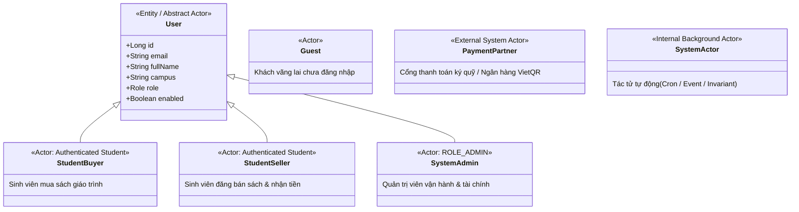
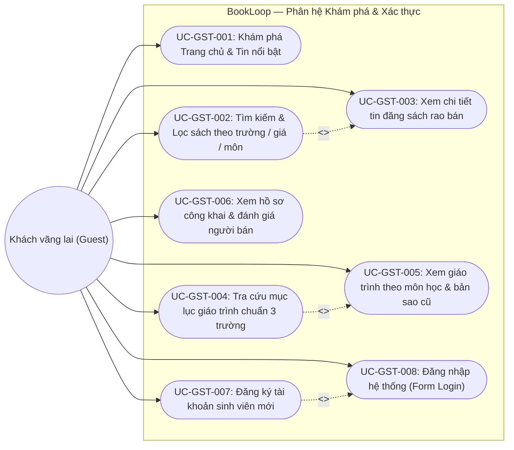
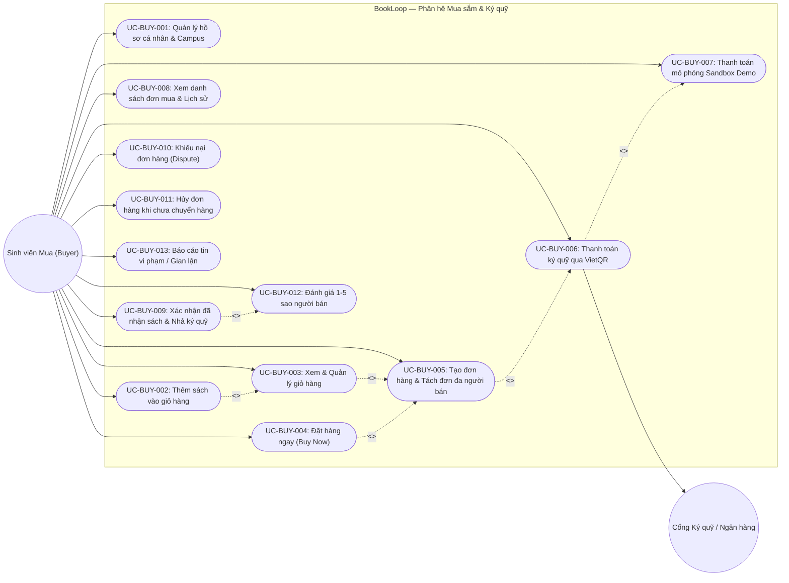
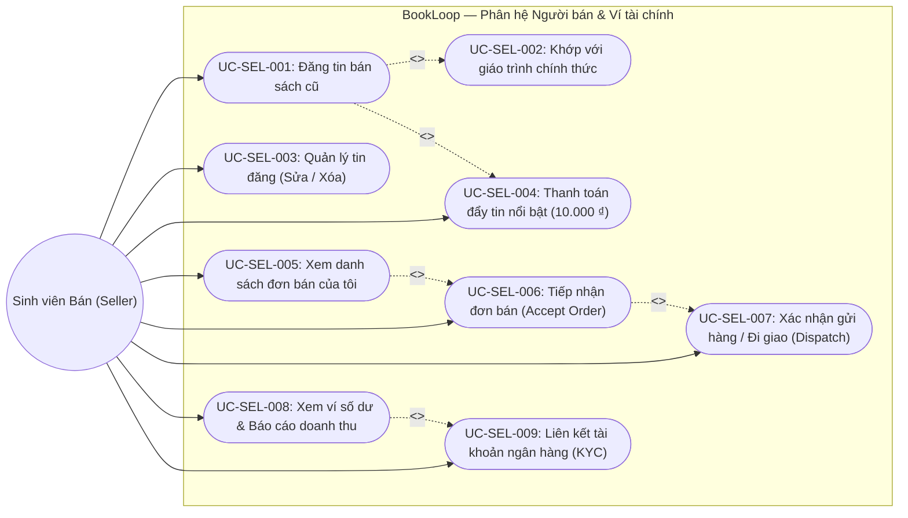
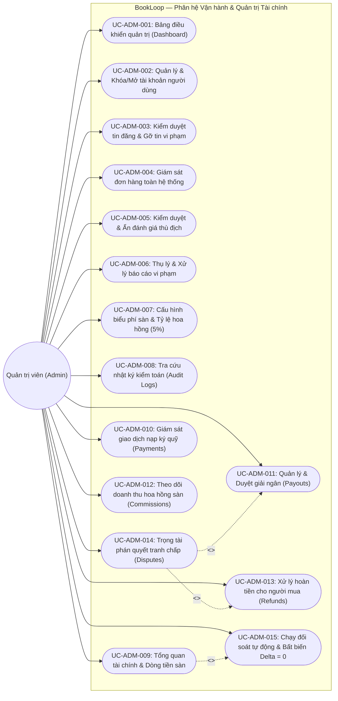
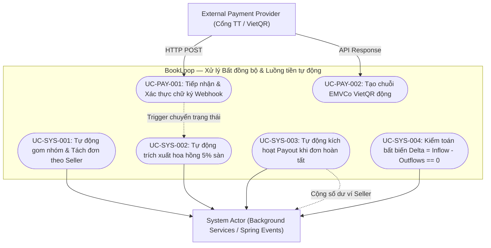

# BOOKLOOP — SƠ ĐỒ USE CASE TOÀN HỆ THỐNG (USE CASE DIAGRAMS)

Tài liệu này cung cấp tập hợp các sơ đồ Use Case chuẩn UML (sử dụng cú pháp Mermaid) mô hình hóa trực quan ranh giới hệ thống (**System Boundary**), các tác tử (**Actors**) và toàn bộ các ca sử dụng của nền tảng **BookLoop C2C Student Marketplace**.

---

## 1. Sơ đồ Tổng quan Ranh giới Hệ thống và Phân cấp Tác tử (Actors Hierarchy)

---

## 2. Phân hệ 1: Sơ đồ Use Case Khách vãng lai (Guest Use Cases)

Khách vãng lai có thể khám phá toàn bộ kho tri thức, tìm kiếm sách cũ và tra cứu giáo trình chuẩn 3 trường mà không cần đăng nhập.

---

## 3. Phân hệ 2: Sơ đồ Use Case Sinh viên Mua (Student Buyer Use Cases)

Bao gồm toàn bộ quy trình mua hàng: giỏ hàng, đặt hàng tách đơn đa người bán, thanh toán ký quỹ bảo vệ người mua, xác nhận nhận sách, đánh giá và khiếu nại.

---

## 4. Phân hệ 3: Sơ đồ Use Case Sinh viên Bán (Student Seller Use Cases)

Bao gồm việc đăng bán sách (khớp danh mục giáo trình), quảng cáo tin nổi bật, xử lý đơn bán, theo dõi ví số dư và nhận tiền giải ngân.

---

## 5. Phân hệ 4: Sơ đồ Use Case Quản trị viên (System Admin Use Cases)

Bao gồm kiểm duyệt người dùng, tin đăng, đơn hàng, cấu hình biểu phí, trọng tài tranh chấp và đối soát tài chính tự động.

---

## 6. Phân hệ 5: Sơ đồ Tác tử Hệ thống & Cổng Thanh toán (External & System Actors)

