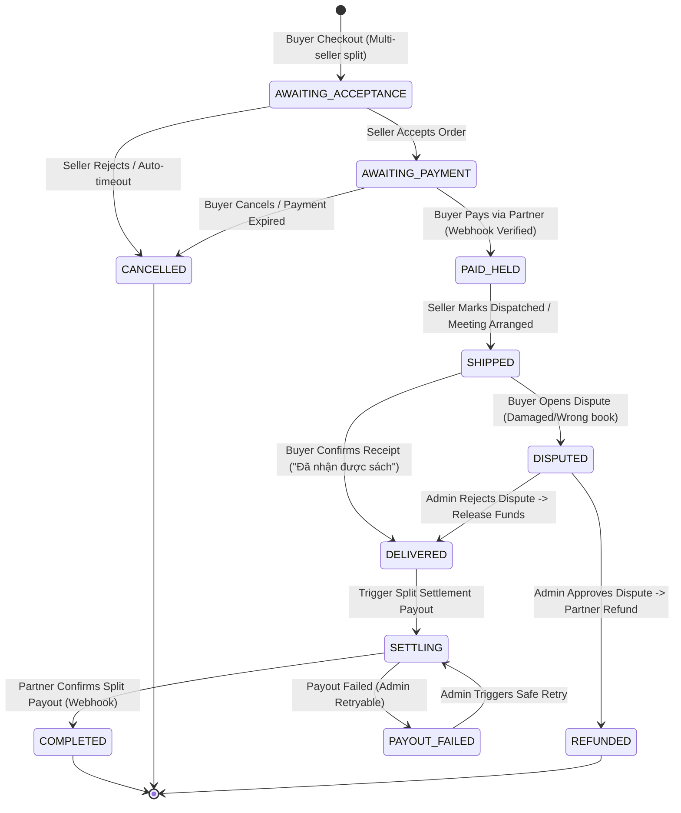

# BOOKLOOP MARKETPLACE PAYMENT SYSTEM ARCHITECTURE
## Conditional Fund Holding, Seller Payout, Commission, Refund, Dispute & Financial Reconciliation

---

## 1. EXISTING ARCHITECTURE REVIEW

### 1.1 Technology Stack
- **Framework**: Spring Boot 3.3.5 on Java 17.
- **Security**: Spring Security 6 (Session-based, BCrypt, Role-based `ROLE_STUDENT`, `ROLE_ADMIN`).
- **Data & Persistence**: Spring Data JPA, Hibernate 6.5.3, Microsoft SQL Server (production) / H2 (testing).
- **Presentation**: Thymeleaf with Bootstrap 5, FontAwesome 6, Inter font, custom CSS `bookloop.css`.
- **Architecture**: Modular Monolith organized by domain entities, repositories, services, DTOs, controllers.

### 1.2 Existing Entities & Limitations
1. **`User`**: Supports `STUDENT` and `ADMIN` roles, campus affiliation, email, phone, full name. Currently lacks structured payment recipient information (bank account or partner recipient identity).
2. **`Product`**: Represents second-hand textbook listings posted by student sellers (`ListingStatus.AVAILABLE`, `SOLD`, `HIDDEN`). Prices are in VND (`BigDecimal`).
3. **`Cart` & `CartItem`**: Stores items per buyer. Can contain items from multiple distinct sellers.
4. **`Order` & `OrderItem`**:
   - `Order` currently has `orderNumber`, `buyer`, `totalAmount`, `paymentMethod`, `status`, `items`.
   - Each `OrderItem` holds snapshot information (`product`, `seller`, `priceAtPurchase`, `quantity`).
   - Prior payment methods only encompassed `IN_PERSON_MEETUP` and `BANK_TRANSFER` without digital holding or marketplace split settlement.
   - Status was limited to `PENDING`, `CONFIRMED`, `COMPLETED`, `CANCELLED`.
5. **`PromotionPayment`**: Handles optional seller listing promotion fee (10,000 VND), strictly isolated from book trade transactions.
6. **Prior Flow Limitation**: In C2C direct bank transfer or meetup, the platform held no visibility into actual money transfers, leading to risks of non-delivery, disputes without proof, and lack of monetizable transaction commissions.

---

## 2. BUSINESS REQUIREMENTS & COMPLIANCE

### 2.1 The Business Model: Partner-Managed Conditional Fund Holding & Split Settlement
BookLoop operates as a pure C2C educational marketplace connecting university students across campuses (FPT University, VNU Hanoi, Academy of Finance).
- **Core Principle**: BookLoop **does not own books**, **does not hold buyer funds in a standard proprietary bank account**, and **does not operate an unlicensed private digital wallet (ví điện tử)** under Vietnamese financial regulations (Decree 52/2024/ND-CP on non-cash payments).
- **Partner Holding**: Buyer pays through a licensed payment intermediary partner (e.g. VNPAY, MoMo, or licensed escrow gateway).
- **Conditional Escrow**: The partner safely holds the funds during order transit and student meetup.
- **Split Settlement**: Upon the buyer verifying book delivery and condition ("Đã nhận được sách"), BookLoop initiates a conditional disbursement instruction to the partner. The partner dispatches:
  - **Seller Net Amount** $\to$ Direct to Seller's recipient account/wallet.
  - **Platform Commission** $\to$ Direct to BookLoop's corporate commission account.

### 2.2 Commission Policy
- **Formula**:
  $$\text{Commission} = \text{Eligible Transaction Amount} \times \text{Commission Rate}$$
  $$\text{Seller Net Amount} = \text{Seller Gross Amount} - \text{Commission} - \text{Applicable Partner Fees}$$
- **Configurability**: Configured dynamically by Admin (`CommissionSettings`), with timestamps for effective periods (`effective_from`, `effective_to`).
- **Immutable Snapshot**: When an order transaction is created/paid, an immutable snapshot of the active commission rate and calculated amounts is recorded in `CommissionRecords`.

---

## 3. PROPOSED ARCHITECTURE (MODULAR MONOLITH)

```
+-----------------------------------------------------------------------------------------+
|                                    BOOKLOOP CLIENTS                                      |
|   +--------------------+     +---------------------+     +--------------------------+   |
|   |   Buyer Frontend   |     |   Seller Frontend   |     |    Admin Finance Panel   |   |
|   |  Checkout & Pay    |     |  Dashboard & Orders |     | KPI, Audit, Disputes     |   |
+---+--------------------+-----+---------------------+-----+--------------------------+---+
                                            |
                                            v
+-----------------------------------------------------------------------------------------+
|                               BOOKLOOP CONTROLLER LAYER                                  |
|  [CheckoutController]   [BuyerPaymentController]    [SellerFinanceController]           |
|  [AdminFinanceController]   [DisputeController]     [PaymentWebhookController]          |
+-----------------------------------------------------------------------------------------+
                                            |
                                            v
+-----------------------------------------------------------------------------------------+
|                                  CORE SERVICES LAYER                                     |
|  +-----------------------+  +------------------------+  +----------------------------+  |
|  |     OrderService      |  |  PaymentManagerService |  |     CommissionService      |  |
|  +-----------------------+  +------------------------+  +----------------------------+  |
|  +-----------------------+  +------------------------+  +----------------------------+  |
|  |     PayoutService     |  |  DisputeRefundService  |  |    ReconciliationService   |  |
|  +-----------------------+  +------------------------+  +----------------------------+  |
+-----------------------------------------------------------------------------------------+
                                            |
                                            v
+-----------------------------------------------------------------------------------------+
|                              PAYMENT PROVIDER ABSTRACTION                                |
|   +---------------------------------------------------------------------------------+   |
|   |                             PaymentProvider (Interface)                         |   |
|   |  createPaymentSession() | queryPaymentStatus() | verifyWebhook()                |   |
|   |  requestConditionalPayout() | queryPayoutStatus() | requestRefund()              |   |
|   +---------------------------------------------------------------------------------+   |
|              ^                                                         ^                |
|              |                                                         |                |
|   +----------------------+                                  +----------------------+    |
|   |  MockPaymentProvider | (Current Sandbox/DEMO)           | Future Partner (VNPAY|    |
|   |  Simulated Escrow    |                                  | / MoMo Marketplace)  |    |
+---+----------------------+----------------------------------+----------------------+----+
                                            |
                                            v
+-----------------------------------------------------------------------------------------+
|                               PERSISTENCE & AUDIT LAYER                                  |
|   Orders | OrderItems | PaymentTransactions | SellerPaymentAccounts | CommissionRecords |
|   PayoutTransactions | RefundTransactions | Disputes | PaymentWebhooks | AuditLogs      |
+-----------------------------------------------------------------------------------------+
```

---

## 4. DATABASE CHANGES & SCHEMA DESIGN

### 4.1 Schema Tables

1. **`orders` (Enhanced)**:
   - Added `seller_id` (enforces single-seller order boundary for clean split settlement).
   - Added `parent_checkout_group` (links multiple seller orders from a single multi-seller cart checkout).
   - Added timestamps: `accepted_at`, `shipped_at`, `received_confirmed_at`, `completed_at`.
2. **`seller_payment_accounts`**:
   - `id`, `seller_id` (FK), `provider_code`, `provider_recipient_id`, `bank_code`, `account_number_mask`, `account_holder_name`, `kyc_status` (`PENDING`, `VERIFIED`, `REJECTED`), `status` (`ACTIVE`, `INACTIVE`), `created_at`, `updated_at`.
3. **`payment_transactions`**:
   - `id`, `order_id` (FK), `provider_code`, `provider_payment_id`, `merchant_reference`, `amount`, `currency` (VND), `payment_status` (`INITIATED`, `PENDING`, `PAID_HELD`, `FAILED`, `CANCELLED`, `REFUNDED`, `PARTIALLY_REFUNDED`), `payment_method`, `qr_code_data`, `payment_url`, `paid_at`, `created_at`, `updated_at`.
4. **`commission_settings`**:
   - `id`, `commission_rate` (DECIMAL(5,4)), `effective_from`, `effective_to`, `is_active`, `notes`, `updated_by` (FK), `updated_at`.
5. **`commission_records`**:
   - `id`, `order_id` (FK, unique), `seller_id` (FK), `payment_transaction_id` (FK), `gross_amount`, `commission_rate_snapshot`, `commission_amount`, `partner_fee_amount`, `seller_net_amount`, `currency`, `status` (`PENDING_SETTLEMENT`, `SETTLED`, `REVERSED`), `settled_at`, `created_at`.
6. **`payout_transactions`**:
   - `id`, `order_id` (FK), `seller_id` (FK), `commission_record_id` (FK), `provider_code`, `provider_payout_id`, `idempotency_key` (unique), `amount`, `currency`, `status` (`REQUESTED`, `PROCESSING`, `COMPLETED`, `FAILED`, `CANCELLED`), `failure_reason`, `retry_count`, `requested_at`, `completed_at`, `created_at`.
7. **`refund_transactions`**:
   - `id`, `payment_transaction_id` (FK), `order_id` (FK), `dispute_id` (FK, nullable), `provider_refund_id`, `idempotency_key` (unique), `refund_amount`, `refund_type` (`FULL`, `PARTIAL`), `reason`, `status` (`REQUESTED`, `PROCESSING`, `COMPLETED`, `FAILED`, `REJECTED`), `initiated_by` (FK), `created_at`, `completed_at`.
8. **`payment_webhook_events`**:
   - `id`, `provider_code`, `provider_event_id`, `event_type`, `signature_verified`, `raw_payload`, `processing_status` (`PENDING`, `PROCESSED`, `IGNORED`, `FAILED`), `error_message`, `received_at`, `processed_at`.
9. **`disputes`**:
   - `id`, `order_id` (FK), `opened_by` (FK), `reason`, `description`, `evidence_url`, `status` (`OPEN`, `UNDER_REVIEW`, `RESOLVED_REFUND`, `RESOLVED_RELEASE`, `CANCELLED`), `resolution_note`, `resolved_by` (FK), `created_at`, `resolved_at`.
10. **`financial_audit_logs`**:
    - `id`, `actor_id`, `actor_email`, `action`, `entity_type`, `entity_id`, `reference_number`, `amount`, `old_value`, `new_value`, `notes`, `ip_address`, `created_at`.

---

## 5. COMPLETE PAYMENT WORKFLOW & STATE MACHINE



### 5.1 Multi-Seller Cart Handling
When a buyer checks out with books from multiple sellers:
1. The system splits the cart items by `sellerId`.
2. A unique `checkoutGroupReference` (e.g. `CHK-20261104-XXXX`) is assigned.
3. Separate seller-specific orders are created (e.g. `ORD-20261104-XXXX-S1`, `ORD-20261104-XXXX-S2`).
4. Each order has its own seller acceptance, its own payment session, independent delivery confirmation, and individual payout disbursement. This strictly prevents Seller A's delivery delay from holding up Seller B's payout.

---

## 6. API DESIGN

### 6.1 Buyer Endpoints
- `POST /api/checkout/orders`: Creates order group from active cart items.
- `POST /api/orders/{id}/payment-session`: Creates payment transaction & returns partner QR/Redirect URL.
- `GET /api/orders/{id}/payment-status`: Polling endpoint for real-time payment status.
- `POST /api/orders/{id}/confirm-received`: Buyer confirms book receipt, unlocks conditional payout.
- `POST /api/orders/{id}/disputes`: Buyer raises dispute with evidence note.
- `GET /api/orders/{id}/transactions`: Returns financial status of order.

### 6.2 Seller Endpoints
- `POST /api/seller/orders/{id}/accept`: Seller accepts to deliver the order.
- `POST /api/seller/orders/{id}/reject`: Seller rejects order (restores product listing).
- `POST /api/seller/orders/{id}/dispatch`: Seller marks book as dispatched / meetup initiated.
- `GET /api/seller/finance/overview`: Seller financial KPI overview.
- `GET /api/seller/payouts`: History of seller disbursements.
- `GET /api/seller/commissions`: Breakdown of platform commission deductions.
- `GET /api/seller/payment-account`: Retrieves current linked bank/wallet account.
- `POST /api/seller/payment-account/onboard`: Links seller payout account (KYC).

### 6.3 Admin Endpoints
- `GET /api/admin/finance/overview`: System financial overview, revenue, escrow volume.
- `GET /api/admin/finance/payments`: Paginated list of all payment transactions.
- `GET /api/admin/finance/payouts`: Paginated list of all seller payouts.
- `GET /api/admin/finance/commissions`: Paginated list of commission settlements.
- `GET /api/admin/finance/refunds`: Paginated refund transactions.
- `GET /api/admin/finance/disputes`: Dispute management table.
- `GET /api/admin/finance/reconciliation`: Discrepancy detector and reconciliation report.
- `PUT /api/admin/finance/commission-settings`: Updates active platform commission rate.
- `POST /api/admin/finance/payouts/{id}/retry`: Retries an eligible failed payout safely.
- `POST /api/admin/finance/refunds/{id}/approve`: Admin reviews and initiates refund to buyer.
- `POST /api/admin/finance/disputes/{id}/resolve`: Resolves dispute with reason and financial action.

### 6.4 Webhook Endpoint
- `POST /api/webhooks/payments/{provider}`:
  - Signature verification (`X-Signature` or HMAC-SHA256).
  - Idempotency via `PaymentWebhookEvents` deduplication.
  - Secure payload persistence with sensitive card/account data redacted.

---

## 7. FINANCIAL RECONCILIATION & AUDIT

### 7.1 Reconciliation Integrity Checks
The `ReconciliationService` performs automated verification across 5 financial invariant rules:
1. **Holding Invariant**:
   $$\text{Funds In Partner Holding} = \sum \text{PAID\_HELD Payments} - \sum \text{Completed Payouts} - \sum \text{Completed Refunds}$$
2. **Settlement Split Invariant**:
   $$\text{Gross Amount} = \text{Commission Amount} + \text{Seller Net Amount} + \text{Partner Fee}$$
3. **No Duplicate Payout**: An order can only have at most one completed payout transaction.
4. **No Duplicate Commission**: An order can only have one settled commission record.
5. **No Negative Payout**: Seller net amount can never be negative.

---

## 8. SECURITY & ANTI-FRAUD MEASURES

1. **Authorization & IDOR Protection**:
   - Buyers can only pay, view, confirm receipt, or dispute orders where `order.buyer.id == currentUserId`.
   - Sellers can only accept, reject, dispatch, or view finances for orders where `order.seller.id == currentUserId`.
   - All `/admin/finance/**` endpoints strictly require `ROLE_ADMIN`.
2. **Idempotency**:
   - Payment sessions, payout requests, and refund requests use UUID-based idempotency keys to prevent duplicate execution upon retry or network instability.
3. **Webhook Authenticity**:
   - Webhook requests must provide a cryptographic signature verified against `PAYMENT_WEBHOOK_SECRET`.
   - Replay protection verifies timestamps within tolerance ($\pm 5\text{ minutes}$).
4. **Audit Logging**:
   - Any financial state modification writes an immutable record to `FinancialAuditLogs` capturing actor, timestamp, entity type, entity ID, old value, and new value.

---

## 9. PROVIDER INTEGRATION STRATEGY & LIMITATIONS

### 9.1 Evaluation of Vietnamese Payment Landscape
- **Standard Gateways (VNPAY-QR, MoMo Standard, ZaloPay Merchant)**: Standard merchant gateway products deposit all funds directly into the merchant's corporate bank account. They **do not** provide escrow holding for individual C2C sellers and **do not** perform split disbursements to individual students without specialized marketplace contracts.
- **Marketplace Escrow / Split Providers**: Requires specific enterprise marketplace underwriting agreements with licensed intermediary payment entities (Trung gian thanh toán) licensed by the State Bank of Vietnam.
- **Contractual Limitation**: Until BookLoop completes formal corporate entity registration and contracts with a certified payment partner:
  - The system utilizes `MockPaymentProvider` in sandbox mode with explicit `[DEMO / SANDBOX]` labels.
  - Transactions simulate partner conditional holding and split settlement cleanly, adhering to all architectural contracts without deceiving users.

---

## 10. CONCLUSION

The architecture establishes a robust, legally compliant, modular payment subsystem that provides immediate testable functionality via the sandbox provider while maintaining standard interfaces for plug-and-play connection to production payment APIs.

